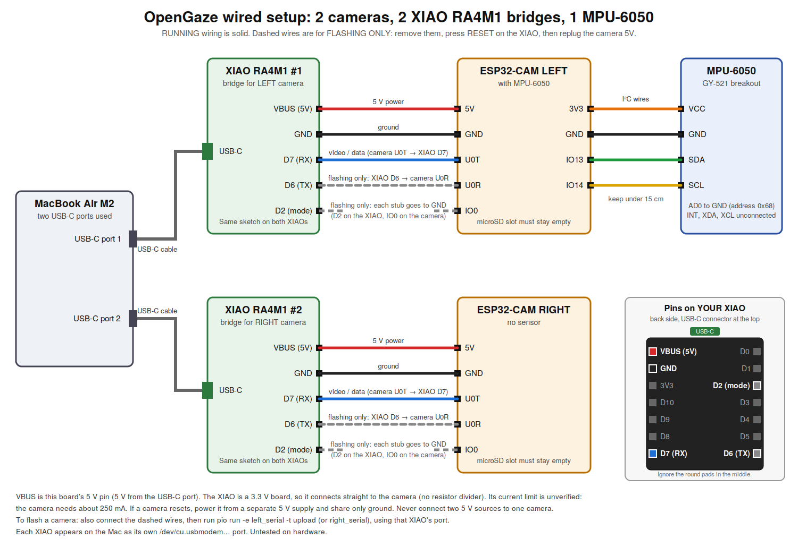

# Wired mode (no Wi-Fi): each camera streams over a USB-serial bridge

Status: **firmware not compiled, nothing run on real hardware.** The receiver side was tested against a software simulator (`receiver/tools/sim_serial_device.py`) at 20 fps / 15 fps, IMU 100 Hz, with injected boot text, noise and corrupted frames.

  (full diagram: docs/wiring-diagram.svg / .png)

## Idea
Each ESP32-CAM sends framed JPEGs (and, on the LEFT camera, IMU packets) out of its UART0 TX pin. A USB-serial bridge carries that to the Mac as a serial port. The bridge can be an Arduino Uno or Nano with **RESET jumpered to GND** (the same trick used for flashing). Two bridges = two ports = two cameras. No Wi-Fi, hotspot or router is involved, and the radio is never started.

## Wiring for RUNNING (per camera)
| Bridge (Uno/Nano) | Camera |
|---|---|
| RESET | GND (jumper on the bridge itself) |
| 5V | 5V |
| GND | GND |
| TX (D1) | **U0T** |

That is all. The Mac never sends anything to the camera in wired mode, so **D0/RX is not connected** (this also keeps the bridge's 5 V signal off the camera's 3.3 V receive pin). IO0 is **not** grounded.
Left camera with MPU-6050: wire the sensor exactly as in `docs/wiring.md` (3V3, GND, IO13 = SDA, IO14 = SCL). Untested.

## Flashing (needs the longer wiring, once per camera)
Use the normal flashing wiring: also **D0 → U0R** and **IO0 → GND**, then:
```bash
source ~/.venvs/opengaze/bin/activate && cd ~/Downloads/opengaze-hw/firmware
pio run -e left_serial  -t upload --upload-port /dev/cu.usbmodemXXXX     # camera with the MPU
pio run -e right_serial -t upload --upload-port /dev/cu.usbmodemYYYY     # the other camera
```
Afterwards remove the **IO0 jumper** and the **D0 → U0R wire**, then unplug/replug the camera's 5V wire. No `secrets.h` is needed in wired mode.
(Flashing is easier if you use the `_serial` firmware only after the Wi-Fi one already worked once.)

## Running on the Mac
```bash
ls /dev/cu.*        # with both bridges plugged in: note the two new names
source ~/.venvs/opengaze-rx/bin/activate && cd ~/Downloads/opengaze-hw/receiver
pip install -r requirements.txt            # adds pyserial
python main.py --left-serial /dev/cu.usbmodemXXXX --right-serial /dev/cu.usbserial-YYYY --baud 921600
```
Headless check: add `--headless --duration 15`. The summary prints frames, fps, CRC errors, garbage bytes and the last text lines the device sent (boot messages).
Close any serial monitor first: only one program can hold a port. Do not use `pio device monitor` for the data stream; it is binary.

## Speed: the real limit
A serial line moves about baud/10 bytes per second: **921600 baud ≈ 92 KB/s** at best. Frame rate ≈ 92 000 / (average frame bytes). The receiver reports bytes and frames; divide to get your average frame size. Smaller frames = higher fps:
- `-DSERIAL_JPEG_QUALITY=18` (4–63, higher = smaller/blurrier), `-DSERIAL_FPS_LIMIT=20`, `-DSERIAL_FRAMESIZE=FRAMESIZE_QVGA`, `-DSERIAL_BAUD=921600` in `platformio.ini` (the `*_serial` envs). Changing these means re-flashing; there is no `/control` page in wired mode.
- **Whether your Uno/Nano bridge passes 921600 is unknown.** If you see no frames, only junk, or many `crc_errors`: lower to `-DSERIAL_BAUD=460800` (then 230400), re-flash, and pass the same `--baud`. Nano clones (CH340) generally handle higher rates than the Uno's USB chip, but I have not tested either.
- IMU and status packets are queued and sent between frames, so the IMU keeps its 100 Hz sampling but packets can arrive up to about one frame time late (their timestamps are still the sampling time).

## What stays the same
`MJPEGClient`-style access (`get_latest()`), the dashboard, IMU parsing, timestamps and the sync helpers. Your team's code can use `SerialCamera` exactly like `MJPEGClient`:
```python
from serial_client import SerialCamera
cam = SerialCamera("left", "/dev/cu.usbmodemXXXX", 921600); cam.start()
frame = cam.get_latest()      # frame.img is a BGR array
```

## Protocol (for reference)
`A5 5A | type u8 | len u32 LE | payload | crc16 LE` — CRC-16/CCITT-FALSE over type+len+payload. Type 1 = JPEG (`capture_us u64, frame_id u32, jpeg`), type 2 = 46-byte IMU packet, type 3 = 50-byte status packet. Anything else on the wire (boot text) is skipped; the parser re-syncs after corruption. The C and Python CRC code were checked against each other on test data.

## Known caveats
- Untested on hardware; firmware uncompiled.
- Power: each camera is fed from its bridge's 5V, i.e. from a Mac USB port (≈ 250 mA camera + bridge). Not measured.
- The ESP32 prints its boot messages at the same baud as the data; the ROM bootloader's first line is at 115200 and appears as junk. That is expected.
- Opening the port from the Mac toggles DTR/RTS on the bridge; with the bridge's own chip held in reset this does not reach the camera.

---
## Using Seeed XIAO RA4M1 boards as the bridges (one per camera)
Camera firmware and receiver are unchanged. The only new piece is `bridge/xiao_ra4m1_bridge/xiao_ra4m1_bridge.ino`, uploaded once to each XIAO from the Arduino IDE (board package: "Seeed Renesas", board "XIAO_RA4M1"; see Seeed's *Getting Started with XIAO RA4M1* page). It is **untested**.

The sketch reads pin **D2** at start-up: D2 to GND = flash mode (115200), open = run mode (921600, must equal `SERIAL_BAUD`). Press RESET on the XIAO after moving the jumper.

**Flashing a camera** (XIAO is 3.3 V, so no resistor divider and no RESET jumper):
| XIAO | Camera |
|---|---|
| TX (D6) | U0R |
| RX (D7) | U0T |
| GND | GND |
| D2 to GND (jumper on the XIAO) | |
| | IO0 to GND (jumper on the camera) |
Power the camera from a 5 V source (the XIAO's VBUS pin, its 5 V pin, normally passes USB power through; its current limit was not verified, the camera needs roughly 250 mA). Then `pio run -e left_serial -t upload --upload-port PORT` (or `right_serial`).

**Running:** remove both jumpers (D2 and IO0) and the TX → U0R wire; press RESET on the XIAO; replug the camera's 5V.
| XIAO | Camera |
|---|---|
| RX (D7) | U0T |
| GND | GND |
| VBUS (this board's 5V pin) | 5V |

**Two XIAOs on one Mac:** each shows up as its own `/dev/cu.usbmodem…` port. Find out which is which by listing ports before and after plugging one in (`ls /dev/cu.usbmodem*`), then `python main.py --left-serial PORT_A --right-serial PORT_B`. Port names can depend on which USB socket is used, so keep each XIAO in the same socket and recheck after any re-plug.

**XIAO pin positions (back side, USB-C up):** left column top to bottom = VBUS(5V), GND, 3V3, D10, D9, D8, D7(RX); right column top to bottom = D0, D1, D2(mode), D3, D4, D5, D6(TX). The round pads in the middle are not used.
